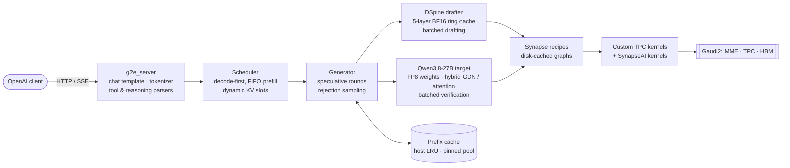

<div align="center">

# GaudiInfer

**A high-performance, high-throughput LLM inference engine purpose-built for Intel® Gaudi®2**

Native C++ on SynapseAI · DSpine speculative decoding · continuous batching · custom TPC kernels

[](#requirements)
[](#build)
[](#requirements)
[](#api)
[](#models)

**English** · [简体中文](README.zh-CN.md)

</div>

---

GaudiInfer (`g2e` in the code) serves **Qwen3.8-27B (FP8)** from a single Gaudi2 card. It talks straight to the SynapseAI graph API: no PyTorch, no Python on the serving path. It accelerates generation with the **DSpine** speculative drafter, and runs up to 8 requests at once with batched verification and drafting.

## Highlights

| | |
|---|---|
| ⚡ **Fast single-stream decoding** | DSpine drafter proposes 16 tokens per round and the target verifies them in one forward pass. Greedy and sampled requests are both speculative; sampled requests use rejection sampling, so the output distribution is unchanged. |
| 🚀 **Continuous batching** | Dynamic slots share one KV budget. Each scheduler step runs decode rounds first, then prefill in FIFO order. Verification and drafting of up to 8 requests are batched into single forwards. |
| 📚 **Long context** | Up to **262,144 tokens**. FP8 SDPA prefill attention and a custom masked-softmax kernel for verification. Optional FP8 KV cache (`G2E_KV_FP8=1`) doubles capacity. |
| 🧠 **Prefix cache** | Host-memory LRU of KV chunks and GDN/drafter state snapshots, with a pinned-memory pool and background pinning. Multi-turn agent sessions skip almost all of the re-prefill. |
| 🔧 **Custom TPC kernels** | TPC-C kernels written for this model: GDN (gated delta-net) recurrence in WY form and single-token decode, fused RMSNorm + FP8 quantization, gated norm + quantization, SiLU-multiply + quantization, masked softmax, causal conv. |
| 🌐 **OpenAI-compatible server** | `/v1/chat/completions` and `/v1/completions` with streaming, a C++ tokenizer and Jinja chat template (identical to HF), the Qwen3 tool-call parser, an optional reasoning parser, usage stats with `cached_tokens`, and image input. |

## Performance

All numbers are measured on one Gaudi2 card with Qwen3.8-27B FP8 and the DSpine-b16 drafter. The baseline is our previous tuned **vLLM-gaudi** production deployment on the same card.

**Prefill** (single prompt, time to first token):

| Prompt length | 8K | 16K | 32K | 64K |
|---|---:|---:|---:|---:|
| vLLM-gaudi | 1.46 s | 2.91 s | 6.49 s | 14.89 s |
| **GaudiInfer** | **1.34 s** | **2.68 s** | **5.78 s** | **13.65 s** |

**Single-stream decoding** (greedy, speculative):

| | vLLM-gaudi | **GaudiInfer** |
|---|---:|---:|
| Chat prompt, short context | ~180 tok/s | **~357 tok/s** |
| 105K context, per verification round | 37.5 ms | **29.5 ms** (≈543 tok/s) |

**Concurrent serving.** In a TokenSpeed-style benchmark, 8 lanes each with an 11–18K-token context generate 2048 tokens using the model's default sampling. GaudiInfer delivers **~650 tok/s end to end** and **~800 tok/s while all 8 lanes decode**. Prefill of 8 × 13K prompts runs at about 5.5K tok/s.

**Agent turns.** At 90K context with 300 new tokens, the time to first token is **~285 ms**, thanks to the prefix cache and a padded short-tail prefill.

> Tokens per second depend on how many draft tokens the target accepts, so they vary with the prompt. Per-round latencies are the more stable comparison.

## Architecture



One speculative round per request, batched across requests:

1. **Draft.** DSpine proposes 16 tokens from the target's captured hidden features.
2. **Verify.** The target scores all 16 positions in one forward pass. Attention and GDN state are kept per slot.
3. **Accept.** Greedy requests compare with the target's choices; sampled requests use rejection sampling. The accepted prefix is committed to the KV cache and GDN state, and the rest rolls back.

Everything above the Synapse layer is C++. Graphs are compiled once per shape (context buckets, batch sizes) and cached on disk, so later starts take about 30 s.

## Requirements

- Intel **Gaudi2** card with the Habana driver.
- **SynapseAI 1.24** (headers, `libSynapse`, `libtpc_kernels`) and the TPC compiler `tpc-clang`.
- CMake ≥ 3.24, a C++20 compiler, Ninja (recommended).
- Python 3 with NumPy, for the weight converters only.
- Device memory: what the weights, drafter and workspaces leave of the 96 GiB HBM becomes the KV cache (auto budget ≈ 51 GiB ≈ 819K tokens).

## Build

```bash
git clone https://github.com/JChen-318/GaudiInfer.git
cd GaudiInfer
cmake -S . -B build -G Ninja -DCMAKE_BUILD_TYPE=Release
cmake --build build
```

This builds the engine library, the custom TPC kernel library (`tpc/flashinfer_gaudi`) and the server `build/g2e_server`. Set `SYNAPSEAI_ROOT` if the SDK is not installed under `/usr`.

## Models

Convert the checkpoints into `.g2w` weight packs once:

```bash
# target: Qwen3.8-27B FP8 (128x128 block scales -> per-row FP8 scales, fused projections)
python3 tools/convert_qwen35.py  /models/qwen3.8-27b-fp8  packs/qwen3.8-27b.g2w

# speculative drafter: DSpine-b16 (BF16)
python3 tools/convert_dspine.py  /models/qwen3.8-27b-dspine-b16  packs/dspine-b16.g2w

# optional: vision encoder, for image input
python3 tools/convert_vision.py  /models/qwen3.8-27b-fp8  packs/vision.g2w
```

Keeping the packs on a RAM disk (for example `/dev/shm`) brings server start-up down to about 30 seconds.

## Run

```bash
sudo ./build/g2e_server \
    --model-dir    /models/qwen3.8-27b-fp8 \
    --target-pack  packs/qwen3.8-27b.g2w \
    --draft-pack   packs/dspine-b16.g2w \
    --vision-pack  packs/vision.g2w \
    --served-model-name qwen3.8-27b \
    --port 8000 --max-model-len 262144 --slots 8 \
    --reasoning-parser qwen3
```

Set `G2E_RECIPE_CACHE=/path/to/dir` to keep compiled graphs across restarts. The first start compiles them, which takes about 10 minutes. `tools/server_ctl.sh start|stop|restart` wraps this command as a background service.

| Option | Default | Meaning |
|---|---|---|
| `--max-model-len` | 32768 | Longest prompt + completion (up to 262144) |
| `--slots` | 8 | Requests resident at once |
| `--kv-cache-gib` | 0 (auto) | KV budget shared by all slots |
| `--draft-pack` | none | Enables DSpine speculative decoding |
| `--vision-pack` | none | Enables image input (`data:` URLs) |
| `--reasoning-parser` | none | `qwen3`: splits `<think>` into `reasoning_content` |
| `--api-key` | none | Require `Authorization: Bearer <key>` |

## API

```bash
curl http://localhost:8000/v1/chat/completions -H 'Content-Type: application/json' -d '{
  "model": "qwen3.8-27b",
  "messages": [{"role": "user", "content": "Explain speculative decoding in two sentences."}],
  "stream": true
}'
```

| Endpoint | |
|---|---|
| `POST /v1/chat/completions` | Chat, streaming or not; tools; images; `stream_options.continuous_usage_stats` |
| `POST /v1/completions` | Raw completions |
| `GET /v1/models`, `/health`, `/version` | Discovery and liveness |
| `GET /stats` | Slots, KV usage, prefix-cache hits, throughput |

Requests and responses follow vLLM's OpenAI-compatible server, so existing clients work unchanged.

## Configuration switches

| Variable | Effect |
|---|---|
| `G2E_RECIPE_CACHE=DIR` | On-disk cache of compiled Synapse graphs |
| `G2E_KV_FP8=1` | FP8 (E4M3) KV cache: 2× KV and prefix-cache capacity, same speed |
| `G2E_NO_BATCH=1` | Run requests' rounds one by one instead of batched |
| `G2E_BATCH_PROF=1`, `G2E_VERIFY_PROF=1` | Per-part timings of batched rounds |
| `G2E_PREFILL_LOG=1` | Timing of every prefill forward pass and state snapshot |

## Repository layout

```
apps/                 g2e_server: HTTP server, scheduler, OpenAI request/response handling
include/g2e/, src/    engine: runtime, graph builder, ops, Qwen3.8 target, GDN, DSpine drafter,
                      generator, prefix cache, tokenizer, vision encoder, Qwen3 parser
tpc/flashinfer_gaudi/ custom TPC-C kernels and their Synapse glue
tools/                weight converters (.g2w packs) and the server launcher
third_party/          cpp-httplib, nlohmann/json, stb_image, llama.cpp unicode / jinja (vendored)
```

## Status and roadmap

GaudiInfer is under active development and targets one model on one card.

- [x] FP8 target, DSpine speculation (greedy and sampled), 262K context
- [x] Continuous batching with batched verification and drafting
- [x] Prefix cache, image input, OpenAI-compatible API
- [x] Optional FP8 KV cache
- [ ] Tree speculation (several draft branches per round)
- [ ] Fused long-context attention (scores and probabilities kept in SRAM)
- [ ] ≥ 1000 tok/s aggregate decoding with 8 lanes

## Acknowledgements

- [cpp-httplib](https://github.com/yhirose/cpp-httplib), [nlohmann/json](https://github.com/nlohmann/json), [stb_image](https://github.com/nothings/stb), and the unicode and Jinja code of [llama.cpp](https://github.com/ggml-org/llama.cpp) (vendored under `third_party/` with their licenses).
- The Qwen team for the Qwen3.8 models, and the DSpine authors for the speculative drafter.
- Intel Habana for the Gaudi2 SynapseAI SDK and the TPC toolchain.
