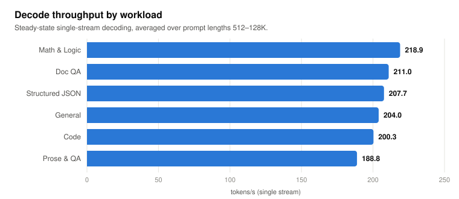
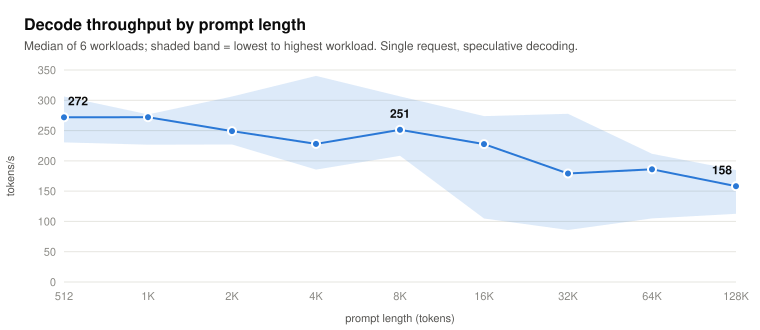

<div align="center">

# GaudiInfer

**A high-performance, high-throughput LLM inference engine purpose-built for Intel® Gaudi®2**

Native C++ on SynapseAI · DSpine speculative decoding · continuous batching · custom TPC kernels

[](#requirements)
[](#build)
[](#requirements)
[](#api)
[](#models)

**English** · [简体中文](README.zh-CN.md)

</div>

---

GaudiInfer (`g2e` in the code) serves **Qwen3.8-27B (FP8)** from a single Gaudi2 card. It talks straight to the SynapseAI graph API: no PyTorch, no Python on the serving path. It accelerates generation with the **DSpine** speculative drafter, and runs up to 8 requests at once with batched verification and drafting.

## Highlights

| | |
|---|---|
| ⚡ **Fast single-stream decoding** | DSpine drafter proposes 16 tokens per round and the target verifies them in one forward pass. Greedy and sampled requests are both speculative; sampled requests use rejection sampling, so the output distribution is unchanged. |
| 🚀 **Continuous batching** | Dynamic slots share one KV budget. Each scheduler step runs decode rounds first, then prefill in FIFO order. Verification and drafting of up to 8 requests are batched into single forwards. |
| 📚 **Long context** | Up to **262,144 tokens**. FP8 SDPA prefill attention and a custom masked-softmax kernel for verification. Optional FP8 KV cache (`G2E_KV_FP8=1`) doubles capacity. |
| 🧠 **Prefix cache** | Host-memory LRU of KV chunks and GDN/drafter state snapshots, with a pinned-memory pool and background pinning. Multi-turn agent sessions skip almost all of the re-prefill. |
| 🔧 **Custom TPC kernels** | TPC-C kernels written for this model: GDN (gated delta-net) recurrence in WY form and single-token decode, fused RMSNorm + FP8 quantization, gated norm + quantization, SiLU-multiply + quantization, masked softmax, causal conv. |
| 🌐 **OpenAI-compatible server** | `/v1/chat/completions` and `/v1/completions` with streaming, a C++ tokenizer and Jinja chat template (identical to HF), the Qwen3 tool-call parser, an optional reasoning parser, usage stats with `cached_tokens`, and image input. |

## Performance

Measured with **[TokenSpeed](https://github.com/1CatAI/TokenSpeed)**'s all-workloads sequence test on one Gaudi2 card: Qwen3.8-27B FP8 with the DSpine-b16 drafter, one request at a time over the OpenAI-compatible API, 6 workloads × 9 prompt lengths from 512 to 131,072 tokens. **All 54 runs succeeded.**

| Decode, single stream | Inter-token latency (P50) | Peak prefill | 128K-token prompt, first token |
|:---:|:---:|:---:|:---:|
| **205 tok/s**<br><sub>6-workload average, 189–219</sub> | **24.7 ms**<br><sub>24.5–24.9 across workloads</sub> | **6,161 tok/s**<br><sub>8K prompt</sub> | **36.4 s**<br><sub>General workload</sub> |

<picture>
  <source media="(prefers-color-scheme: dark)" srcset="docs/images/prefill-dark.svg">
  
</picture>

<picture>
  <source media="(prefers-color-scheme: dark)" srcset="docs/images/decode-workload-dark.svg">
  
</picture>

<picture>
  <source media="(prefers-color-scheme: dark)" srcset="docs/images/decode-length-dark.svg">
  
</picture>

- **Prefill** runs at 5.5–5.8K tok/s for prompts of 2K–32K tokens and still 3.5K tok/s at 128K, where attention dominates.
- **Decoding** keeps a median above 160 tok/s up to 128K context; the inter-token latency grows only from 23 ms to 30 ms over that range.
- **Workloads** differ by 1.16×: speculative decoding gains most on math and logic, least on free-form prose.

**By workload**

| Workload | Decode (tok/s) | vs General | TTFT P50 | Inter-token P50 |
|---|---:|---:|---:|---:|
| General | 203.96 | baseline | 6,822 ms | 24.9 ms |
| Code | 200.32 | -1.8% | 6,896 ms | 24.6 ms |
| Structured JSON | 207.69 | +1.8% | 6,897 ms | 24.7 ms |
| Prose & QA | 188.82 | -7.4% | 8,118 ms | 24.8 ms |
| Doc QA | 211.00 | +3.5% | 7,731 ms | 24.7 ms |
| Math & Logic | 218.95 | +7.3% | 6,911 ms | 24.5 ms |

**By prompt length** (mean of the 6 workloads; decode: median)

| Prompt (tokens) | TTFT | Inter-token | Prefill (tok/s) | Decode (tok/s) |
|---:|---:|---:|---:|---:|
| 512 | 156 ms | 22.9 ms | 3,704 | 225 |
| 1,024 | 235 ms | 23.2 ms | 4,731 | 227 |
| 2,048 | 390 ms | 23.0 ms | 5,552 | 229 |
| 4,096 | 741 ms | 23.5 ms | 5,647 | 239 |
| 8,192 | 1,457 ms | 23.5 ms | 5,847 | 210 |
| 16,384 | 2,892 ms | 23.9 ms | 5,711 | 195 |
| 32,768 | 6,201 ms | 25.0 ms | 5,480 | 190 |
| 65,536 | 14.6 s | 26.6 ms | 4,655 | 175 |
| 131,072 | 38.6 s | 30.4 ms | 3,524 | 162 |

<details>
<summary><b>All 54 runs</b></summary>


**General**

| Prompt | TTFT (ms) | Inter-token (ms) | Prefill (tok/s) | Decode (tok/s) |
|---:|---:|---:|---:|---:|
| 512 | 101.59 | 23.10 | 5,167.04 | 251.76 |
| 1,024 | 185.17 | 23.15 | 5,601.95 | 307.09 |
| 2,048 | 335.01 | 23.47 | 6,155.62 | 272.52 |
| 4,096 | 668.10 | 24.69 | 6,152.20 | 272.77 |
| 8,192 | 1,334.70 | 23.54 | 6,160.71 | 247.00 |
| 16,384 | 2,737.77 | 23.76 | 5,969.91 | 97.90 |
| 32,768 | 5,873.38 | 25.12 | 5,581.41 | 169.82 |
| 65,536 | 13,763.80 | 27.09 | 4,755.54 | 143.09 |
| 131,072 | 36,400.16 | 30.50 | 3,601.10 | 73.63 |

**Code**

| Prompt | TTFT (ms) | Inter-token (ms) | Prefill (tok/s) | Decode (tok/s) |
|---:|---:|---:|---:|---:|
| 512 | 150.84 | 23.34 | 3,522.43 | 220.42 |
| 1,024 | 239.42 | 23.70 | 4,485.58 | 224.97 |
| 2,048 | 393.45 | 23.55 | 5,336.92 | 208.90 |
| 4,096 | 730.03 | 23.57 | 5,682.59 | 208.78 |
| 8,192 | 1,403.01 | 22.93 | 5,873.46 | 169.09 |
| 16,384 | 2,797.60 | 23.44 | 5,875.69 | 194.96 |
| 32,768 | 5,959.40 | 24.66 | 5,507.37 | 225.63 |
| 65,536 | 13,917.90 | 26.69 | 4,712.42 | 169.95 |
| 131,072 | 36,880.34 | 29.74 | 3,594.26 | 172.09 |

**Structured JSON**

| Prompt | TTFT (ms) | Inter-token (ms) | Prefill (tok/s) | Decode (tok/s) |
|---:|---:|---:|---:|---:|
| 512 | 162.95 | 23.14 | 3,430.92 | 230.39 |
| 1,024 | 241.00 | 22.63 | 4,483.09 | 226.19 |
| 2,048 | 395.29 | 22.55 | 5,313.79 | 210.07 |
| 4,096 | 730.23 | 23.49 | 5,682.30 | 209.45 |
| 8,192 | 1,407.15 | 25.07 | 5,860.05 | 260.60 |
| 16,384 | 2,805.34 | 24.20 | 5,859.58 | 195.86 |
| 32,768 | 5,953.50 | 24.20 | 5,512.97 | 195.80 |
| 65,536 | 13,892.25 | 26.32 | 4,721.18 | 180.00 |
| 131,072 | 36,502.01 | 31.03 | 3,592.17 | 152.73 |

**Prose & QA**

| Prompt | TTFT (ms) | Inter-token (ms) | Prefill (tok/s) | Decode (tok/s) |
|---:|---:|---:|---:|---:|
| 512 | 181.78 | 22.19 | 3,320.22 | 192.33 |
| 1,024 | 233.68 | 22.85 | 5,040.11 | 180.62 |
| 2,048 | 404.62 | 23.08 | 5,740.24 | 226.05 |
| 4,096 | 817.83 | 23.82 | 5,672.01 | 260.52 |
| 8,192 | 1,636.13 | 23.34 | 5,633.61 | 210.06 |
| 16,384 | 3,153.77 | 23.57 | 5,040.91 | 226.22 |
| 32,768 | 6,900.97 | 25.49 | 5,361.60 | 161.93 |
| 65,536 | 16,299.45 | 27.13 | 4,533.99 | 117.94 |
| 131,072 | 43,849.19 | 30.93 | 3,394.15 | 114.92 |

**Doc QA**

| Prompt | TTFT (ms) | Inter-token (ms) | Prefill (tok/s) | Decode (tok/s) |
|---:|---:|---:|---:|---:|
| 512 | 165.42 | 23.42 | 3,623.69 | 246.17 |
| 1,024 | 286.86 | 23.46 | 3,997.82 | 227.28 |
| 2,048 | 431.47 | 23.07 | 5,227.45 | 231.07 |
| 4,096 | 787.53 | 22.93 | 5,673.05 | 232.46 |
| 8,192 | 1,533.54 | 22.71 | 5,769.71 | 152.26 |
| 16,384 | 3,009.24 | 24.42 | 5,751.92 | 249.52 |
| 32,768 | 6,547.09 | 24.70 | 5,422.93 | 184.43 |
| 65,536 | 15,491.90 | 26.22 | 4,503.54 | 195.20 |
| 131,072 | 41,260.62 | 30.80 | 3,451.12 | 180.62 |

**Math & Logic**

| Prompt | TTFT (ms) | Inter-token (ms) | Prefill (tok/s) | Decode (tok/s) |
|---:|---:|---:|---:|---:|
| 512 | 176.31 | 22.45 | 3,159.70 | 211.07 |
| 1,024 | 224.84 | 23.63 | 4,776.96 | 270.72 |
| 2,048 | 379.25 | 22.49 | 5,536.05 | 247.37 |
| 4,096 | 712.69 | 22.71 | 5,022.32 | 244.95 |
| 8,192 | 1,424.67 | 23.49 | 5,786.17 | 209.45 |
| 16,384 | 2,850.73 | 23.95 | 5,765.30 | 172.33 |
| 32,768 | 5,974.09 | 26.03 | 5,492.70 | 245.72 |
| 65,536 | 13,945.72 | 25.95 | 4,702.09 | 197.26 |
| 131,072 | 36,531.26 | 29.62 | 3,509.22 | 171.65 |

</details>

### Versus vLLM-gaudi

Our previous tuned vLLM-gaudi deployment on the same card, same model:

| | vLLM-gaudi | **GaudiInfer** |
|---|---:|---:|
| Prefill, 8K / 32K / 64K prompt | 1.46 / 6.49 / 14.89 s | **1.34 / 5.78 / 13.65 s** |
| Single-stream decoding, chat prompt | ~180 tok/s | **~357 tok/s** (greedy) |
| Verification round at 105K context | 37.5 ms | **29.5 ms** |

**Concurrent serving.** With 8 lanes of 11–18K-token contexts each generating 2048 tokens (TokenSpeed concurrency test, default sampling), GaudiInfer delivers **~650 tok/s end to end** and **~800 tok/s while all 8 lanes decode**. **Agent turns** at 90K context with 300 new tokens get their first token in **~285 ms** thanks to the prefix cache.

> Throughput in tokens/s depends on how many draft tokens the target accepts, so it varies with the content; per-round latencies are the steadier comparison.

## Architecture


One speculative round per request, batched across requests:

1. **Draft.** DSpine proposes 16 tokens from the target's captured hidden features.
2. **Verify.** The target scores all 16 positions in one forward pass. Attention and GDN state are kept per slot.
3. **Accept.** Greedy requests compare with the target's choices; sampled requests use rejection sampling. The accepted prefix is committed to the KV cache and GDN state, and the rest rolls back.

Everything above the Synapse layer is C++. Graphs are compiled once per shape (context buckets, batch sizes) and cached on disk, so later starts take about 30 s.

## Requirements

- Intel **Gaudi2** card with the Habana driver.
- **SynapseAI 1.24** (headers, `libSynapse`, `libtpc_kernels`) and the TPC compiler `tpc-clang`.
- CMake ≥ 3.24, a C++20 compiler, Ninja (recommended).
- Python 3 with NumPy, for the weight converters only.
- Device memory: what the weights, drafter and workspaces leave of the 96 GiB HBM becomes the KV cache (auto budget ≈ 51 GiB ≈ 819K tokens).

## Build

```bash
git clone https://github.com/JChen-318/GaudiInfer.git
cd GaudiInfer
cmake -S . -B build -G Ninja -DCMAKE_BUILD_TYPE=Release
cmake --build build
```

This builds the engine library, the custom TPC kernel library (`tpc/flashinfer_gaudi`) and the server `build/g2e_server`. Set `SYNAPSEAI_ROOT` if the SDK is not installed under `/usr`.

## Models

Convert the checkpoints into `.g2w` weight packs once:

```bash
# target: Qwen3.8-27B FP8 (128x128 block scales -> per-row FP8 scales, fused projections)
python3 tools/convert_qwen35.py  /models/qwen3.8-27b-fp8  packs/qwen3.8-27b.g2w

# speculative drafter: DSpine-b16 (BF16)
python3 tools/convert_dspine.py  /models/qwen3.8-27b-dspine-b16  packs/dspine-b16.g2w

# optional: vision encoder, for image input
python3 tools/convert_vision.py  /models/qwen3.8-27b-fp8  packs/vision.g2w
```

Keeping the packs on a RAM disk (for example `/dev/shm`) brings server start-up down to about 30 seconds.

## Run

```bash
sudo ./build/g2e_server \
    --model-dir    /models/qwen3.8-27b-fp8 \
    --target-pack  packs/qwen3.8-27b.g2w \
    --draft-pack   packs/dspine-b16.g2w \
    --vision-pack  packs/vision.g2w \
    --served-model-name qwen3.8-27b \
    --port 8000 --max-model-len 262144 --slots 8 \
    --reasoning-parser qwen3
```

Set `G2E_RECIPE_CACHE=/path/to/dir` to keep compiled graphs across restarts. The first start compiles them, which takes about 10 minutes. `tools/server_ctl.sh start|stop|restart` wraps this command as a background service.

| Option | Default | Meaning |
|---|---|---|
| `--max-model-len` | 32768 | Longest prompt + completion (up to 262144) |
| `--slots` | 8 | Requests resident at once |
| `--kv-cache-gib` | 0 (auto) | KV budget shared by all slots |
| `--draft-pack` | none | Enables DSpine speculative decoding |
| `--vision-pack` | none | Enables image input (`data:` URLs) |
| `--reasoning-parser` | none | `qwen3`: splits `<think>` into `reasoning_content` |
| `--api-key` | none | Require `Authorization: Bearer <key>` |

## API

```bash
curl http://localhost:8000/v1/chat/completions -H 'Content-Type: application/json' -d '{
  "model": "qwen3.8-27b",
  "messages": [{"role": "user", "content": "Explain speculative decoding in two sentences."}],
  "stream": true
}'
```

| Endpoint | |
|---|---|
| `POST /v1/chat/completions` | Chat, streaming or not; tools; images; `stream_options.continuous_usage_stats` |
| `POST /v1/completions` | Raw completions |
| `GET /v1/models`, `/health`, `/version` | Discovery and liveness |
| `GET /stats` | Slots, KV usage, prefix-cache hits, throughput |

Requests and responses follow vLLM's OpenAI-compatible server, so existing clients work unchanged.

## Configuration switches

| Variable | Effect |
|---|---|
| `G2E_RECIPE_CACHE=DIR` | On-disk cache of compiled Synapse graphs |
| `G2E_KV_FP8=1` | FP8 (E4M3) KV cache: 2× KV and prefix-cache capacity, same speed |
| `G2E_NO_BATCH=1` | Run requests' rounds one by one instead of batched |
| `G2E_BATCH_PROF=1`, `G2E_VERIFY_PROF=1` | Per-part timings of batched rounds |
| `G2E_PREFILL_LOG=1` | Timing of every prefill forward pass and state snapshot |

## Repository layout

```
apps/                 g2e_server: HTTP server, scheduler, OpenAI request/response handling
include/g2e/, src/    engine: runtime, graph builder, ops, Qwen3.8 target, GDN, DSpine drafter,
                      generator, prefix cache, tokenizer, vision encoder, Qwen3 parser
tpc/flashinfer_gaudi/ custom TPC-C kernels and their Synapse glue
tools/                weight converters (.g2w packs) and the server launcher
third_party/          cpp-httplib, nlohmann/json, stb_image, llama.cpp unicode / jinja (vendored)
```

## Status and roadmap

GaudiInfer is under active development and targets one model on one card.

- [x] FP8 target, DSpine speculation (greedy and sampled), 262K context
- [x] Continuous batching with batched verification and drafting
- [x] Prefix cache, image input, OpenAI-compatible API
- [x] Optional FP8 KV cache
- [ ] Tree speculation (several draft branches per round)
- [ ] Fused long-context attention (scores and probabilities kept in SRAM)
- [ ] ≥ 1000 tok/s aggregate decoding with 8 lanes

## Acknowledgements

- [cpp-httplib](https://github.com/yhirose/cpp-httplib), [nlohmann/json](https://github.com/nlohmann/json), [stb_image](https://github.com/nothings/stb), and the unicode and Jinja code of [llama.cpp](https://github.com/ggml-org/llama.cpp) (vendored under `third_party/` with their licenses).
- The Qwen team for the Qwen3.8 models, and the DSpine authors for the speculative drafter.
- Intel Habana for the Gaudi2 SynapseAI SDK and the TPC toolchain.
