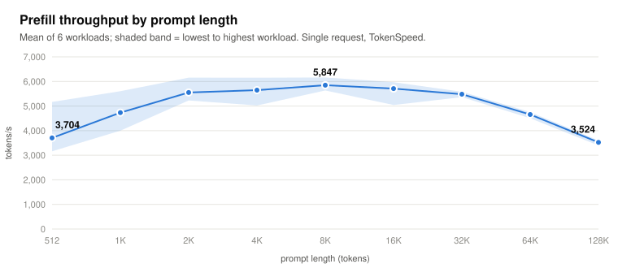

<div align="center">

# GaudiInfer

**A high-performance native C++ multimodal inference engine purpose-built for Intel® Gaudi®2**

Native C++ on SynapseAI · Direct MME + SRAM · Custom TPC kernels · LLM/VLM · Image & Video Diffusion · Unified Studio WebUI

[](#requirements)
[](#build)
[](#requirements)
[](#api)
[](#models)

**English** · [简体中文](README.zh-CN.md)

</div>

---

GaudiInfer (`g2e` in the code) runs four native C++ inference engines on a **single Intel Gaudi2 (96 GiB HBM2E)** card — directly on SynapseAI + custom TPC-C kernels + Direct MME/SRAM execution, with zero PyTorch or Python on the inference path:

- **Qwen3.8-27B (FP8 + DSpine-b16 + Vision)** — 262K-context LLM/VLM with speculative decoding and continuous batching (`g2e_server`).
- **Qwen-Image-2.1-Turbo (FP8 DiT + BF16 VAE/VLM)** — 8-step text-to-image & 1–4 reference image editing (`g2e_qwen21_server`).
- **MiniMax-H3-Image (33.1B FP8 DiT + 2D VAE)** — 6-step PDD 2K / 4K (16 MP) text-to-image & 1–16 reference image editing (`g2e_h3_image_server`).
- **MiniMax-H3 Video + Stereo Audio (FP8 DiT + 3D VideoVAE + AudioVAE)** — T2VA / I2VA / FL2VA video-audio generation with runtime-swappable 4-step & 8-step Turbo LoRA (`g2e_h3_server`, `g2e_h3_cli`).
- **GaudiInfer Studio & Monitor WebUI (`:8002`)** — unified bilingual (中文 / English) workbench with real-time Gaudi2 hardware telemetry, one-click single-card engine switching, persistent media gallery, and cross-model handoff.

## Highlights

| | |
|---|---|
| ⚡ **Fast single-stream decoding** | DSpine drafter proposes 16 tokens per round and the target verifies them in one forward pass. Greedy and sampled requests are both speculative; sampled requests use rejection sampling, so the output distribution is unchanged. |
| 🚀 **Continuous batching** | Dynamic slots share one KV budget. Each scheduler step runs decode rounds first, then prefill in FIFO order. Verification and drafting of up to 8 requests are batched into single forwards. |
| 📚 **Long context** | Up to **262,144 tokens**. FP8 SDPA prefill attention and a custom masked-softmax kernel for verification. Optional FP8 KV cache (`G2E_KV_FP8=1`) doubles capacity. |
| 🧠 **Prefix cache** | Host-memory LRU of KV chunks and GDN/drafter state snapshots, with a pinned-memory pool and background pinning. Multi-turn agent sessions skip almost all of the re-prefill. |
| 🔧 **Custom TPC kernels** | TPC-C kernels written for this model: GDN (gated delta-net) recurrence in WY form and single-token decode, fused RMSNorm + FP8 quantization, gated norm + quantization, SiLU-multiply + quantization, masked softmax, causal conv. |
| 🌐 **OpenAI-compatible server** | `/v1/chat/completions` and `/v1/completions` with streaming, a C++ tokenizer and Jinja chat template (identical to HF), the Qwen3 tool-call parser, an optional reasoning parser, usage stats with `cached_tokens`, and image input. |

## Performance

Measured with the all-workloads sequence test of **[llm_speedtest](https://github.com/gengchaogit/llm_speedtest)** on one Gaudi2 card: Qwen3.8-27B FP8 with the DSpine-b16 drafter, one request at a time over the OpenAI-compatible API, 6 workloads × 9 prompt lengths from 512 to 131,072 tokens. **All 54 runs succeeded.**

| Decode, single stream | Inter-token latency (mean) | Peak prefill | 128K-token prompt, first token |
|:---:|:---:|:---:|:---:|
| **222 tok/s**<br><sub>6-workload average, 185–260</sub> | **23.0 ms**<br><sub>22.6–23.3 across workloads</sub> | **8,791 tok/s**<br><sub>4K prompt</sub> | **25.8 s**<br><sub>General workload</sub> |

<picture>
  <source media="(prefers-color-scheme: dark)" srcset="docs/images/prefill-dark.svg">
  
</picture>

<picture>
  <source media="(prefers-color-scheme: dark)" srcset="docs/images/decode-workload-dark.svg">
  
</picture>

<picture>
  <source media="(prefers-color-scheme: dark)" srcset="docs/images/decode-length-dark.svg">
  
</picture>

- **Prefill** runs at 7.3–8.5K tok/s for prompts of 2K–32K tokens (peaking at 8,791 tok/s at 4K) and still 5.0K tok/s at 128K, where attention dominates.
- **Decoding** keeps a median of 228–272 tok/s up to 16K context and ~158 tok/s at 128K; the inter-token latency grows only from 21.3 ms to 29.4 ms over that range.
- **Workloads** differ by 1.41×: speculative decoding gains most on document QA and structured JSON, least on free-form prose.

**By workload**

| Workload | Decode (tok/s) | vs General | TTFT mean | Inter-token mean |
|---|---:|---:|---:|---:|
| General | 212.34 | baseline | 4,919 ms | 22.6 ms |
| Code | 222.97 | +5.0% | 4,972 ms | 23.3 ms |
| Structured JSON | 242.64 | +14.3% | 4,977 ms | 23.0 ms |
| Prose & QA | 184.83 | -13.0% | 5,796 ms | 23.2 ms |
| Doc QA | 259.71 | +22.3% | 5,570 ms | 23.2 ms |
| Math & Logic | 209.49 | -1.3% | 4,984 ms | 23.1 ms |

**By prompt length** (mean of the 6 workloads; decode: median)

| Prompt (tokens) | TTFT | Inter-token | Prefill (tok/s) | Decode (tok/s) |
|---:|---:|---:|---:|---:|
| 512 | 107 ms | 22.1 ms | 5,308 | 272 |
| 1,024 | 172 ms | 22.0 ms | 6,434 | 272 |
| 2,048 | 278 ms | 21.4 ms | 7,813 | 249 |
| 4,096 | 506 ms | 21.3 ms | 8,462 | 228 |
| 8,192 | 1,050 ms | 21.7 ms | 8,125 | 251 |
| 16,384 | 2,167 ms | 21.5 ms | 7,850 | 228 |
| 32,768 | 4,652 ms | 22.6 ms | 7,300 | 179 |
| 65,536 | 10.7 s | 25.3 ms | 6,345 | 186 |
| 131,072 | 27.2 s | 29.4 ms | 4,997 | 158 |

<details>
<summary><b>All 54 runs</b></summary>


**General**

| Prompt | TTFT (ms) | Inter-token (ms) | Prefill (tok/s) | Decode (tok/s) |
|---:|---:|---:|---:|---:|
| 512 | 97.31 | 20.89 | 5,370.56 | 306.20 |
| 1,024 | 147.16 | 21.45 | 7,055.63 | 248.57 |
| 2,048 | 248.08 | 21.78 | 8,321.33 | 244.79 |
| 4,096 | 467.93 | 21.74 | 8,790.80 | 226.40 |
| 8,192 | 965.52 | 20.83 | 8,502.18 | 276.93 |
| 16,384 | 2,004.41 | 20.86 | 8,182.12 | 125.19 |
| 32,768 | 4,413.45 | 22.07 | 7,427.94 | 161.10 |
| 65,536 | 10,165.83 | 24.74 | 6,447.95 | 191.59 |
| 131,072 | 25,757.95 | 28.89 | 5,088.99 | 130.27 |

**Code**

| Prompt | TTFT (ms) | Inter-token (ms) | Prefill (tok/s) | Decode (tok/s) |
|---:|---:|---:|---:|---:|
| 512 | 103.90 | 22.21 | 5,400.95 | 230.44 |
| 1,024 | 170.33 | 23.18 | 6,316.38 | 275.99 |
| 2,048 | 271.33 | 20.62 | 7,750.63 | 248.21 |
| 4,096 | 491.74 | 21.54 | 8,444.48 | 185.62 |
| 8,192 | 1,017.48 | 23.00 | 8,106.35 | 252.75 |
| 16,384 | 2,091.24 | 21.77 | 7,861.18 | 226.06 |
| 32,768 | 4,472.60 | 23.17 | 7,338.59 | 197.25 |
| 65,536 | 10,268.78 | 24.89 | 6,387.21 | 205.62 |
| 131,072 | 25,859.74 | 28.85 | 5,070.53 | 184.77 |

**Structured JSON**

| Prompt | TTFT (ms) | Inter-token (ms) | Prefill (tok/s) | Decode (tok/s) |
|---:|---:|---:|---:|---:|
| 512 | 104.91 | 22.66 | 5,364.04 | 268.88 |
| 1,024 | 171.05 | 21.02 | 6,295.07 | 276.70 |
| 2,048 | 272.16 | 21.99 | 7,729.04 | 306.18 |
| 4,096 | 492.90 | 21.29 | 8,425.29 | 300.47 |
| 8,192 | 1,020.51 | 21.06 | 8,082.52 | 209.52 |
| 16,384 | 2,094.99 | 21.46 | 7,847.33 | 229.30 |
| 32,768 | 4,503.81 | 23.40 | 7,287.83 | 248.44 |
| 65,536 | 10,265.41 | 25.30 | 6,389.38 | 180.68 |
| 131,072 | 25,866.77 | 28.98 | 5,069.18 | 163.57 |

**Prose & QA**

| Prompt | TTFT (ms) | Inter-token (ms) | Prefill (tok/s) | Decode (tok/s) |
|---:|---:|---:|---:|---:|
| 512 | 113.11 | 23.26 | 5,332.78 | 305.59 |
| 1,024 | 189.13 | 21.54 | 6,368.41 | 269.92 |
| 2,048 | 311.05 | 20.88 | 7,623.37 | 226.99 |
| 4,096 | 545.15 | 21.45 | 8,479.07 | 229.50 |
| 8,192 | 1,160.54 | 21.93 | 7,997.51 | 208.38 |
| 16,384 | 2,391.38 | 21.43 | 7,740.80 | 104.76 |
| 32,768 | 5,102.73 | 22.25 | 7,225.41 | 100.93 |
| 65,536 | 11,840.41 | 24.89 | 6,208.61 | 104.92 |
| 131,072 | 30,509.85 | 30.74 | 4,830.31 | 112.52 |

**Doc QA**

| Prompt | TTFT (ms) | Inter-token (ms) | Prefill (tok/s) | Decode (tok/s) |
|---:|---:|---:|---:|---:|
| 512 | 114.62 | 22.16 | 5,218.56 | 275.00 |
| 1,024 | 179.22 | 22.22 | 6,423.35 | 274.09 |
| 2,048 | 291.15 | 21.10 | 7,761.97 | 252.71 |
| 4,096 | 542.22 | 20.89 | 8,247.23 | 340.21 |
| 8,192 | 1,111.52 | 21.97 | 7,992.93 | 306.49 |
| 16,384 | 2,300.34 | 21.50 | 7,724.95 | 246.36 |
| 32,768 | 4,941.10 | 23.03 | 7,185.67 | 277.74 |
| 65,536 | 11,355.82 | 26.28 | 6,253.15 | 211.71 |
| 131,072 | 29,292.92 | 29.86 | 4,861.11 | 153.09 |

**Math & Logic**

| Prompt | TTFT (ms) | Inter-token (ms) | Prefill (tok/s) | Decode (tok/s) |
|---:|---:|---:|---:|---:|
| 512 | 108.24 | 21.57 | 5,160.14 | 247.13 |
| 1,024 | 174.60 | 22.58 | 6,148.08 | 226.68 |
| 2,048 | 273.43 | 22.24 | 7,689.91 | 250.13 |
| 4,096 | 495.19 | 20.86 | 8,383.07 | 211.54 |
| 8,192 | 1,021.91 | 21.18 | 8,068.93 | 249.72 |
| 16,384 | 2,122.59 | 22.24 | 7,744.83 | 273.92 |
| 32,768 | 4,476.08 | 21.92 | 7,332.66 | 85.88 |
| 65,536 | 10,277.36 | 25.81 | 6,381.69 | 177.09 |
| 131,072 | 25,902.46 | 29.01 | 5,062.09 | 163.36 |

</details>

### Versus vLLM-gaudi

Our previous tuned vLLM-gaudi deployment on the same card, same model:

| | vLLM-gaudi | **GaudiInfer** |
|---|---:|---:|
| Prefill, 8K / 32K / 64K prompt | 1.46 / 6.49 / 14.89 s | **0.97 / 4.41 / 10.17 s** |
| Single-stream decoding, chat prompt | ~180 tok/s | **~357 tok/s** (greedy) |
| Verification round at 105K context | 37.5 ms | **29.5 ms** |

**Concurrent serving.** With 8 lanes of 11–18K-token contexts each generating 2048 tokens (TokenSpeed concurrency test, default sampling), GaudiInfer delivers **~650 tok/s end to end** and **~800 tok/s while all 8 lanes decode**. **Agent turns** at 90K context with 300 new tokens get their first token in **~285 ms** thanks to the prefix cache.

> Throughput in tokens/s depends on how many draft tokens the target accepts, so it varies with the content; per-round latencies are the steadier comparison.

### Multimodal Image & Video Diffusion (Single Gaudi2)

All diffusion servers expose OpenAI-compatible (`/v1/images/generations`, `/v1/images/edits`) and ComfyUI-compatible HTTP endpoints with zero Python on the inference path:

| Engine | Server Binary | HBM | Measured End-to-End HTTP Latency | Capabilities |
|---|---|---:|---|---|
| **Qwen-Image-2.1-Turbo** | `g2e_qwen21_server` (`:8098`) | 22.6 GiB | **2.34 s** (1024² T2I, 8 steps) · **4.2 s** (1–4 ref edit) | FP8 DiT + BF16 3D VAE + Qwen3.5-VL-4B |
| **MiniMax-H3-Image** | `g2e_h3_image_server` (`:8099`) | 56.9 GiB | **4.67 s** (2K T2I, 6-step PDD) · **22.4 s** (4K 16 MP) | 33.1B FP8 DiT + 2D VAE (0.91 s) + 1–16 ref edit |
| **MiniMax-H3 Video** | `g2e_h3_server` (`:8097`) | ~62 GiB | **~10–30 s** (480p/768p 5 s, 4/8-step Turbo LoRA) | DirectH3Attn + Streaming VideoVAE + Stereo AudioVAE, T2VA / I2VA / FL2VA |

### Unified Studio & Monitor WebUI

A zero-dependency Python 3 stdlib workbench (`monitor/server.py`, port `8002`) integrates all four engines and real-time `hl-smi` telemetry:

```bash
./monitor/studio_ctl.sh start   # opens on http://<host>:8002
```

- **Monitor-first landing page**: real-time Gaudi2 AIP utilization, HBM, 54V+12V power, temperature, SoC clock, live throughput charts, engine logs, and one-click single-card engine switcher.
- **Multimodal creation workspaces**: 27B Chat + Vision, Qwen-Image-2.1 T2I/Edit, MiniMax-H3-Image 2K/4K & Multi-Ref Edit, MiniMax-H3 T2VA/I2VA/FL2VA Video+Audio, and a persistent Gallery with one-click cross-model handoff (image → edit / video first-frame / 27B vision analysis).
- **Bilingual UI & Light/Dark themes**: instant **中 / EN** toggle in the top bar.

## Architecture


One speculative round per request, batched across requests:

1. **Draft.** DSpine proposes 16 tokens from the target's captured hidden features.
2. **Verify.** The target scores all 16 positions in one forward pass. Attention and GDN state are kept per slot.
3. **Accept.** Greedy requests compare with the target's choices; sampled requests use rejection sampling. The accepted prefix is committed to the KV cache and GDN state, and the rest rolls back.

Everything above the Synapse layer is C++. Graphs are compiled once per shape (context buckets, batch sizes) and cached on disk, so later starts take about 30 s.

## Requirements

- Intel **Gaudi2** card with the Habana driver.
- **SynapseAI 1.24** (headers, `libSynapse`, `libtpc_kernels`) and the TPC compiler `tpc-clang`.
- CMake ≥ 3.24, a C++20 compiler, Ninja (recommended).
- Python 3 with NumPy, for the weight converters only.
- Device memory: what the weights, drafter and workspaces leave of the 96 GiB HBM becomes the KV cache (auto budget ≈ 51 GiB ≈ 819K tokens).

## Build

```bash
git clone https://github.com/JChen-318/GaudiInfer.git
cd GaudiInfer
cmake -S . -B build -G Ninja -DCMAKE_BUILD_TYPE=Release
cmake --build build
```

This builds the engine library, the custom TPC kernel library (`tpc/flashinfer_gaudi`) and the server `build/g2e_server`. Set `SYNAPSEAI_ROOT` if the SDK is not installed under `/usr`.

## Models

Convert the checkpoints into `.g2w` weight packs once:

```bash
# target: Qwen3.8-27B FP8 (128x128 block scales -> per-row FP8 scales, fused projections)
python3 tools/convert_qwen35.py  /models/qwen3.8-27b-fp8  packs/qwen3.8-27b.g2w

# speculative drafter: DSpine-b16 (BF16)
python3 tools/convert_dspine.py  /models/qwen3.8-27b-dspine-b16  packs/dspine-b16.g2w

# optional: vision encoder, for image input
python3 tools/convert_vision.py  /models/qwen3.8-27b-fp8  packs/vision.g2w
```

Keeping the packs on a RAM disk (for example `/dev/shm`) brings server start-up down to about 30 seconds.

### Inkling-2-Mini

`g2e_server` also serves [thinkingmachines/Inkling-2-Mini](https://huggingface.co/thinkingmachines/Inkling-2-Mini) (a looped MoE model: 24 stored layers, 48 layer applications per token, with native NVFP4 experts in layers 0-19 and MXFP8 experts in layers 20-23 stored without rounding in a 17.65 GiB pack) with up to 8 slots, batched decode, DSpark speculative decoding, image input, configurable on-device BF16 weight caching (`G2E_INK_BF16_CACHE`), and contexts up to 1M tokens. It has its own converters, pack verifier, SCAL config (`tools/scal-g2e-ink.json`), and engine switches: see [docs/inkling2.md](docs/inkling2.md).

## Run

```bash
sudo ./build/g2e_server \
    --model-dir    /models/qwen3.8-27b-fp8 \
    --target-pack  packs/qwen3.8-27b.g2w \
    --draft-pack   packs/dspine-b16.g2w \
    --vision-pack  packs/vision.g2w \
    --served-model-name qwen3.8-27b \
    --port 8000 --max-model-len 262144 --slots 8 \
    --reasoning-parser qwen3
```

Set `G2E_RECIPE_CACHE=/path/to/dir` to keep compiled graphs across restarts. The first start compiles them, which takes about 10 minutes. `tools/server_ctl.sh start|stop|restart` wraps this command as a background service.

### Docker

A multi-stage `Dockerfile` (pure C++ Ubuntu 24.04 + SynapseAI runtime, no PyTorch) and `docker-compose.yml` are included:

```bash
docker compose build
docker compose up -d
```

Override host paths or serving options via environment variables (`G2E_HOST_MODEL_DIR`, `G2E_HOST_PACKS_DIR`, `G2E_HOST_RECIPES_DIR`, `G2E_PORT`, `G2E_MAX_MODEL_LEN`, `G2E_SLOTS`, `HABANA_VERSION`). When `/dev/shm/g2e/*.g2w` is present on the host (`ipc: host`), the entrypoint automatically loads the RAM-cached packs.

| Option | Default | Meaning |
|---|---|---|
| `--max-model-len` | 32768 | Longest prompt + completion (up to 262144) |
| `--slots` | 8 | Requests resident at once |
| `--kv-cache-gib` | 0 (auto) | KV budget shared by all slots |
| `--draft-pack` | none | Enables DSpine speculative decoding |
| `--vision-pack` | none | Enables image input (`data:` URLs) |
| `--reasoning-parser` | none | `qwen3`: splits `<think>` into `reasoning_content` |
| `--api-key` | none | Require `Authorization: Bearer <key>` |

## API

```bash
curl http://localhost:8000/v1/chat/completions -H 'Content-Type: application/json' -d '{
  "model": "qwen3.8-27b",
  "messages": [{"role": "user", "content": "Explain speculative decoding in two sentences."}],
  "stream": true
}'
```

| Endpoint | |
|---|---|
| `POST /v1/chat/completions` | Chat, streaming or not; tools; images; `stream_options.continuous_usage_stats` |
| `POST /v1/completions` | Raw completions |
| `GET /v1/models`, `/health`, `/version` | Discovery and liveness |
| `GET /stats` | Slots, KV usage, prefix-cache hits, throughput |

Requests and responses follow vLLM's OpenAI-compatible server, so existing clients work unchanged.

## Configuration switches

| Variable | Effect |
|---|---|
| `G2E_RECIPE_CACHE=DIR` | On-disk cache of compiled Synapse graphs |
| `G2E_KV_FP8=1` | FP8 (E4M3) KV cache: 2× KV and prefix-cache capacity, same speed |
| `G2E_NO_BATCH=1` | Run requests' rounds one by one instead of batched |
| `G2E_BATCH_PROF=1`, `G2E_VERIFY_PROF=1` | Per-part timings of batched rounds |
| `G2E_PREFILL_LOG=1` | Timing of every prefill forward pass and state snapshot |

## Repository layout

```
apps/                 g2e_server (27B LLM/VLM), g2e_qwen21_server, g2e_h3_image_server,
                      g2e_h3_server, g2e_h3_cli
include/g2e/, src/    core SynapseAI + Direct MME/SRAM engines (Qwen3.8-27B + GDN + DSpine,
                      Qwen-Image-2.1, MiniMax-H3-Image, MiniMax-H3 Video & Audio)
tpc/flashinfer_gaudi/ custom TPC-C kernels (GDN, norm+quant, softmax, H3 AdaLN/RoPE/DirectAttn)
monitor/              GaudiInfer Studio & Monitor WebUI (bilingual ZH/EN, zero pip deps)
tools/                weight converters (.g2w packs), MME descriptors, and launchers
third_party/          cpp-httplib, nlohmann/json, stb_image, llama.cpp unicode / jinja (vendored)
```

## Status and roadmap

GaudiInfer is under active development and targets single-card Gaudi2 deployments.

- [x] Qwen3.8-27B FP8 target, DSpine speculation (greedy and sampled), 262K context, continuous batching, prefix cache, vision input, optional FP8 KV cache
- [x] Fused long-context attention (Direct MME + SRAM engine, scores and probabilities kept in SRAM)
- [x] Native MiniMax-H3 Video + Stereo Audio engine (DirectH3Attn, streaming VideoVAE, runtime 4/8-step Turbo LoRA, FL2VA)
- [x] Native Qwen-Image-2.1-Turbo (1024² in 2.34 s) & MiniMax-H3-Image (2K in 4.67 s, 4K 16 MP in 22.4 s)
- [x] Unified bilingual (ZH/EN) Studio & Monitor WebUI with single-card engine switching and persistent gallery
- [ ] Tree speculation (several draft branches per round)
- [ ] ≥ 1000 tok/s aggregate decoding with 8 lanes

## Acknowledgements

- [cpp-httplib](https://github.com/yhirose/cpp-httplib), [nlohmann/json](https://github.com/nlohmann/json), [stb_image](https://github.com/nothings/stb), and the unicode and Jinja code of [llama.cpp](https://github.com/ggml-org/llama.cpp) (vendored under `third_party/` with their licenses).
- The Qwen team for the Qwen3.8 models, and the DSpine authors for the speculative drafter.
- Intel Habana for the Gaudi2 SynapseAI SDK and the TPC toolchain.
