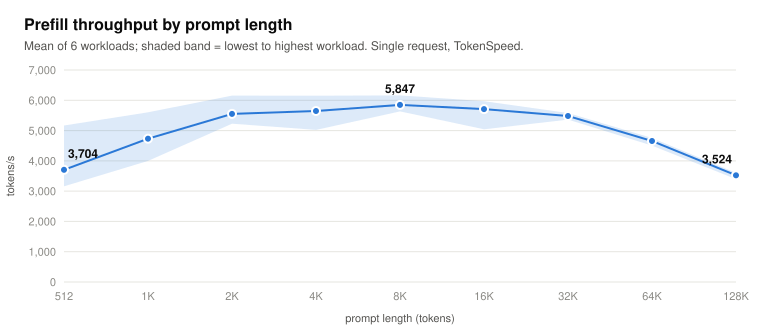
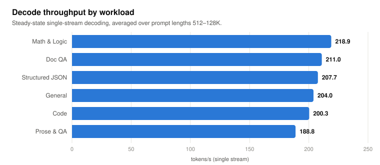
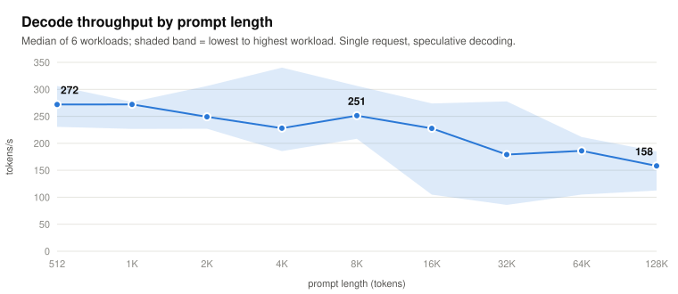
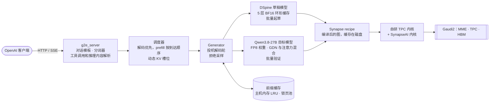

<div align="center">

# GaudiInfer

**为 Intel® Gaudi®2 打造的高性能、高吞吐大模型推理引擎**

原生 C++ · 直接调用 SynapseAI · DSpine 投机解码 · 连续批处理 · 自研 TPC 内核

[](#环境要求)
[](#编译)
[](#环境要求)
[](#api)
[](#模型准备)

[English](README.md) · **简体中文**

</div>

---

GaudiInfer（代码里叫 `g2e`）在单张 Gaudi2 上运行 **Qwen3.8-27B（FP8）**。它直接调用 SynapseAI 的图接口，服务路径上不用 PyTorch，也没有 Python。生成时用 **DSpine** 投机草稿模型加速，最多 8 个请求同时运行，各请求的验证和起草都合批执行。

## 亮点

| | |
|---|---|
| ⚡ **单路解码快** | DSpine 每轮起草 16 个 token，目标模型一次前向全部验证。贪心和采样请求都走投机解码；采样请求用拒绝采样，输出分布不变。 |
| 🚀 **连续批处理** | 动态槽位共享一份 KV 预算。调度器每一步先跑解码轮，再按到达顺序做 prefill。最多 8 个请求的验证和起草各合成一次前向。 |
| 📚 **长上下文** | 最长 **262,144 token**。prefill 用 FP8 SDPA，验证用自研的 masked softmax 内核。可选 FP8 KV 缓存（`G2E_KV_FP8=1`），容量翻倍。 |
| 🧠 **前缀缓存** | 在主机内存里按 LRU 缓存 KV 块和 GDN、草稿模型的状态快照，配锁页内存池和后台锁页。多轮 agent 对话几乎不用重新 prefill。 |
| 🔧 **自研 TPC 内核** | 为这个模型专门写的 TPC-C 内核：WY 形式的 GDN（门控 delta-net）递推和单 token 解码、融合 RMSNorm + FP8 量化、门控归一化 + 量化、SiLU 乘法 + 量化、masked softmax、因果卷积。 |
| 🌐 **兼容 OpenAI 的服务** | `/v1/chat/completions` 和 `/v1/completions`，支持流式输出。C++ 实现的分词器和 Jinja 对话模板（与 HF 结果一致）、Qwen3 工具调用解析、可选的推理内容解析、带 `cached_tokens` 的用量统计，以及图片输入。 |

## 性能

用 **[llm_speedtest](https://github.com/gengchaogit/llm_speedtest)** 的全场景顺序测试，在一张 Gaudi2 上实测：Qwen3.8-27B FP8 加 DSpine-b16 草稿模型，通过 OpenAI 兼容 API 一次跑一个请求，6 类任务 × 9 种 prompt 长度（512 到 131,072 token）。**54 组全部成功。**

| 单路解码 | 出字间隔（均值） | prefill 峰值 | 128K prompt 首 token |
|:---:|:---:|:---:|:---:|
| **222 tok/s**<br><sub>6 类任务平均，185–260</sub> | **23.0 ms**<br><sub>各任务 22.6–23.3</sub> | **8,791 tok/s**<br><sub>4K prompt</sub> | **25.8 s**<br><sub>通用混合任务</sub> |

<picture>
  <source media="(prefers-color-scheme: dark)" srcset="docs/images/prefill-dark.svg">
  
</picture>

<picture>
  <source media="(prefers-color-scheme: dark)" srcset="docs/images/decode-workload-dark.svg">
  
</picture>

<picture>
  <source media="(prefers-color-scheme: dark)" srcset="docs/images/decode-length-dark.svg">
  
</picture>

- **Prefill**：2K 到 32K 的 prompt 约 7.3K–8.5K tok/s（4K 峰值 8,791 tok/s），128K 时注意力占大头，仍有约 5.0K tok/s。
- **解码**：16K 以内中位数保持在 228–272 tok/s，上下文到 128K 时仍有约 158 tok/s，出字间隔只从 21.3 ms 增加到 29.4 ms。
- **任务之间**相差 1.41 倍：投机解码在文档知识库和结构化 JSON 上收益最大，在自由行文的散文上最小。

**按任务**

| 任务 | 解码（tok/s） | 相对通用混合 | 首 token 均值 | 出字间隔均值 |
|---|---:|---:|---:|---:|
| 通用混合 | 212.34 | 基准 | 4,919 ms | 22.6 ms |
| 代码解码 | 222.97 | +5.0% | 4,972 ms | 23.3 ms |
| 结构化 JSON | 242.64 | +14.3% | 4,977 ms | 23.0 ms |
| 散文问答 | 184.83 | -13.0% | 5,796 ms | 23.2 ms |
| 文档知识库 | 259.71 | +22.3% | 5,570 ms | 23.2 ms |
| 数理逻辑 | 209.49 | -1.3% | 4,984 ms | 23.1 ms |

**按 prompt 长度**（6 类任务的平均值；解码取中位数）

| prompt（token） | 首 token | 出字间隔 | prefill（tok/s） | 解码（tok/s） |
|---:|---:|---:|---:|---:|
| 512 | 107 ms | 22.1 ms | 5,308 | 272 |
| 1,024 | 172 ms | 22.0 ms | 6,434 | 272 |
| 2,048 | 278 ms | 21.4 ms | 7,813 | 249 |
| 4,096 | 506 ms | 21.3 ms | 8,462 | 228 |
| 8,192 | 1,050 ms | 21.7 ms | 8,125 | 251 |
| 16,384 | 2,167 ms | 21.5 ms | 7,850 | 228 |
| 32,768 | 4,652 ms | 22.6 ms | 7,300 | 179 |
| 65,536 | 10.7 s | 25.3 ms | 6,345 | 186 |
| 131,072 | 27.2 s | 29.4 ms | 4,997 | 158 |

<details>
<summary><b>全部 54 组结果</b></summary>


**通用混合**

| prompt | 首 token（ms） | 出字间隔（ms） | prefill（tok/s） | 解码（tok/s） |
|---:|---:|---:|---:|---:|
| 512 | 97.31 | 20.89 | 5,370.56 | 306.20 |
| 1,024 | 147.16 | 21.45 | 7,055.63 | 248.57 |
| 2,048 | 248.08 | 21.78 | 8,321.33 | 244.79 |
| 4,096 | 467.93 | 21.74 | 8,790.80 | 226.40 |
| 8,192 | 965.52 | 20.83 | 8,502.18 | 276.93 |
| 16,384 | 2,004.41 | 20.86 | 8,182.12 | 125.19 |
| 32,768 | 4,413.45 | 22.07 | 7,427.94 | 161.10 |
| 65,536 | 10,165.83 | 24.74 | 6,447.95 | 191.59 |
| 131,072 | 25,757.95 | 28.89 | 5,088.99 | 130.27 |

**代码解码**

| prompt | 首 token（ms） | 出字间隔（ms） | prefill（tok/s） | 解码（tok/s） |
|---:|---:|---:|---:|---:|
| 512 | 103.90 | 22.21 | 5,400.95 | 230.44 |
| 1,024 | 170.33 | 23.18 | 6,316.38 | 275.99 |
| 2,048 | 271.33 | 20.62 | 7,750.63 | 248.21 |
| 4,096 | 491.74 | 21.54 | 8,444.48 | 185.62 |
| 8,192 | 1,017.48 | 23.00 | 8,106.35 | 252.75 |
| 16,384 | 2,091.24 | 21.77 | 7,861.18 | 226.06 |
| 32,768 | 4,472.60 | 23.17 | 7,338.59 | 197.25 |
| 65,536 | 10,268.78 | 24.89 | 6,387.21 | 205.62 |
| 131,072 | 25,859.74 | 28.85 | 5,070.53 | 184.77 |

**结构化 JSON**

| prompt | 首 token（ms） | 出字间隔（ms） | prefill（tok/s） | 解码（tok/s） |
|---:|---:|---:|---:|---:|
| 512 | 104.91 | 22.66 | 5,364.04 | 268.88 |
| 1,024 | 171.05 | 21.02 | 6,295.07 | 276.70 |
| 2,048 | 272.16 | 21.99 | 7,729.04 | 306.18 |
| 4,096 | 492.90 | 21.29 | 8,425.29 | 300.47 |
| 8,192 | 1,020.51 | 21.06 | 8,082.52 | 209.52 |
| 16,384 | 2,094.99 | 21.46 | 7,847.33 | 229.30 |
| 32,768 | 4,503.81 | 23.40 | 7,287.83 | 248.44 |
| 65,536 | 10,265.41 | 25.30 | 6,389.38 | 180.68 |
| 131,072 | 25,866.77 | 28.98 | 5,069.18 | 163.57 |

**散文问答**

| prompt | 首 token（ms） | 出字间隔（ms） | prefill（tok/s） | 解码（tok/s） |
|---:|---:|---:|---:|---:|
| 512 | 113.11 | 23.26 | 5,332.78 | 305.59 |
| 1,024 | 189.13 | 21.54 | 6,368.41 | 269.92 |
| 2,048 | 311.05 | 20.88 | 7,623.37 | 226.99 |
| 4,096 | 545.15 | 21.45 | 8,479.07 | 229.50 |
| 8,192 | 1,160.54 | 21.93 | 7,997.51 | 208.38 |
| 16,384 | 2,391.38 | 21.43 | 7,740.80 | 104.76 |
| 32,768 | 5,102.73 | 22.25 | 7,225.41 | 100.93 |
| 65,536 | 11,840.41 | 24.89 | 6,208.61 | 104.92 |
| 131,072 | 30,509.85 | 30.74 | 4,830.31 | 112.52 |

**文档知识库**

| prompt | 首 token（ms） | 出字间隔（ms） | prefill（tok/s） | 解码（tok/s） |
|---:|---:|---:|---:|---:|
| 512 | 114.62 | 22.16 | 5,218.56 | 275.00 |
| 1,024 | 179.22 | 22.22 | 6,423.35 | 274.09 |
| 2,048 | 291.15 | 21.10 | 7,761.97 | 252.71 |
| 4,096 | 542.22 | 20.89 | 8,247.23 | 340.21 |
| 8,192 | 1,111.52 | 21.97 | 7,992.93 | 306.49 |
| 16,384 | 2,300.34 | 21.50 | 7,724.95 | 246.36 |
| 32,768 | 4,941.10 | 23.03 | 7,185.67 | 277.74 |
| 65,536 | 11,355.82 | 26.28 | 6,253.15 | 211.71 |
| 131,072 | 29,292.92 | 29.86 | 4,861.11 | 153.09 |

**数理逻辑**

| prompt | 首 token（ms） | 出字间隔（ms） | prefill（tok/s） | 解码（tok/s） |
|---:|---:|---:|---:|---:|
| 512 | 108.24 | 21.57 | 5,160.14 | 247.13 |
| 1,024 | 174.60 | 22.58 | 6,148.08 | 226.68 |
| 2,048 | 273.43 | 22.24 | 7,689.91 | 250.13 |
| 4,096 | 495.19 | 20.86 | 8,383.07 | 211.54 |
| 8,192 | 1,021.91 | 21.18 | 8,068.93 | 249.72 |
| 16,384 | 2,122.59 | 22.24 | 7,744.83 | 273.92 |
| 32,768 | 4,476.08 | 21.92 | 7,332.66 | 85.88 |
| 65,536 | 10,277.36 | 25.81 | 6,381.69 | 177.09 |
| 131,072 | 25,902.46 | 29.01 | 5,062.09 | 163.36 |

</details>

### 与 vLLM-gaudi 对比

对比对象是我们之前在同一张卡、同一个模型上调优过的 vLLM-gaudi 部署：

| | vLLM-gaudi | **GaudiInfer** |
|---|---:|---:|
| prefill，8K / 32K / 64K prompt | 1.46 / 6.49 / 14.89 s | **0.97 / 4.41 / 10.17 s** |
| 单路解码，对话 prompt | 约 180 tok/s | **约 357 tok/s**（贪心） |
| 105K 上下文每轮验证 | 37.5 ms | **29.5 ms** |

**并发服务**：8 路各带 11K 到 18K 上下文、各生成 2048 token（TokenSpeed 并发测试，默认采样），端到端约 **650 tok/s**，8 路同时解码时约 **800 tok/s**。**Agent 回合**：90K 上下文、新增 300 token 时，借助前缀缓存，首 token 约 **285 ms**。

> tok/s 取决于草稿 token 被接受的数量，会随内容变化；每轮耗时是更稳定的比较口径。

## 架构



每个请求每轮做一次投机解码，多个请求合批执行：

1. **起草**：DSpine 根据目标模型捕获的隐藏特征，提出 16 个候选 token。
2. **验证**：目标模型一次前向给 16 个位置打分，注意力和 GDN 状态按槽位分开。
3. **接收**：贪心请求直接和目标模型的选择比较，采样请求用拒绝采样。接收的前缀提交进 KV 缓存和 GDN 状态，其余回滚。

Synapse 以上的部分全是 C++。每种形状（上下文分档、批大小）的图只编译一次并缓存到磁盘，之后启动约 30 秒。

## 环境要求

- Intel **Gaudi2** 卡和 Habana 驱动。
- **SynapseAI 1.24**（头文件、`libSynapse`、`libtpc_kernels`）和 TPC 编译器 `tpc-clang`。
- CMake ≥ 3.24、支持 C++20 的编译器，推荐用 Ninja。
- Python 3 和 NumPy，只有转换权重时需要。
- 显存：96 GiB HBM 减去权重、草稿模型和工作区之后，剩下的都作为 KV 缓存（自动预算约 51 GiB，约 81.9 万 token）。

## 编译

```bash
git clone https://github.com/JChen-318/GaudiInfer.git
cd GaudiInfer
cmake -S . -B build -G Ninja -DCMAKE_BUILD_TYPE=Release
cmake --build build
```

会编译引擎库、自研 TPC 内核库（`tpc/flashinfer_gaudi`）和服务器 `build/g2e_server`。SDK 不在 `/usr` 下时，设置 `SYNAPSEAI_ROOT`。

## 模型准备

先把模型转换成 `.g2w` 权重包，只需要做一次：

```bash
# 目标模型：Qwen3.8-27B FP8（128x128 块缩放转成按行缩放，合并投影矩阵）
python3 tools/convert_qwen35.py  /models/qwen3.8-27b-fp8  packs/qwen3.8-27b.g2w

# 投机草稿模型：DSpine-b16（BF16）
python3 tools/convert_dspine.py  /models/qwen3.8-27b-dspine-b16  packs/dspine-b16.g2w

# 可选：视觉编码器，用于图片输入
python3 tools/convert_vision.py  /models/qwen3.8-27b-fp8  packs/vision.g2w
```

把权重包放在内存盘上（比如 `/dev/shm`），服务器启动可以缩短到约 30 秒。

## 运行

```bash
sudo ./build/g2e_server \
    --model-dir    /models/qwen3.8-27b-fp8 \
    --target-pack  packs/qwen3.8-27b.g2w \
    --draft-pack   packs/dspine-b16.g2w \
    --vision-pack  packs/vision.g2w \
    --served-model-name qwen3.8-27b \
    --port 8000 --max-model-len 262144 --slots 8 \
    --reasoning-parser qwen3
```

设置 `G2E_RECIPE_CACHE=/path/to/dir` 可以让编译好的图在重启后继续使用；第一次启动要编译，约 10 分钟。`tools/server_ctl.sh start|stop|restart` 把上面的命令包装成后台服务。

### Docker 部署

仓库内置了多阶段 `Dockerfile`（纯 C++ Ubuntu 24.04 + SynapseAI 运行时，不含 PyTorch）与 `docker-compose.yml`：

```bash
docker compose build
docker compose up -d
```

可通过环境变量覆盖宿主机路径与服务参数（`G2E_HOST_MODEL_DIR`、`G2E_HOST_PACKS_DIR`、`G2E_HOST_RECIPES_DIR`、`G2E_PORT`、`G2E_MAX_MODEL_LEN`、`G2E_SLOTS`、`HABANA_VERSION`）。当宿主机 `/dev/shm/g2e/*.g2w` 存在时（配合 `ipc: host`），容器入口脚本会自动优先从内存盘加载权重包。

| 参数 | 默认值 | 含义 |
|---|---|---|
| `--max-model-len` | 32768 | prompt 加生成的最大长度（最大 262144） |
| `--slots` | 8 | 同时驻留的请求数 |
| `--kv-cache-gib` | 0（自动） | 所有槽位共享的 KV 预算 |
| `--draft-pack` | 无 | 开启 DSpine 投机解码 |
| `--vision-pack` | 无 | 开启图片输入（`data:` URL） |
| `--reasoning-parser` | 无 | `qwen3`：把 `<think>` 内容拆到 `reasoning_content` |
| `--api-key` | 无 | 要求请求带 `Authorization: Bearer <key>` |

## API

```bash
curl http://localhost:8000/v1/chat/completions -H 'Content-Type: application/json' -d '{
  "model": "qwen3.8-27b",
  "messages": [{"role": "user", "content": "用两句话解释投机解码。"}],
  "stream": true
}'
```

| 接口 | |
|---|---|
| `POST /v1/chat/completions` | 对话，流式或非流式；工具调用；图片；`stream_options.continuous_usage_stats` |
| `POST /v1/completions` | 普通补全 |
| `GET /v1/models`、`/health`、`/version` | 模型列表和存活检查 |
| `GET /stats` | 槽位、KV 用量、前缀缓存命中、吞吐 |

请求和响应格式与 vLLM 的 OpenAI 兼容服务一致，现有客户端不用改。

## 环境变量开关

| 变量 | 作用 |
|---|---|
| `G2E_RECIPE_CACHE=DIR` | 编译好的 Synapse 图的磁盘缓存目录 |
| `G2E_KV_FP8=1` | FP8（E4M3）KV 缓存：KV 和前缀缓存容量翻倍，速度不变 |
| `G2E_NO_BATCH=1` | 各请求逐个跑，不合批 |
| `G2E_BATCH_PROF=1`、`G2E_VERIFY_PROF=1` | 批量轮各部分的耗时 |
| `G2E_PREFILL_LOG=1` | 每次 prefill 前向和状态快照的耗时 |

## 目录结构

```
apps/                 g2e_server：HTTP 服务、调度器、OpenAI 请求和响应处理
include/g2e/, src/    引擎：运行时、图构建、算子、Qwen3.8 目标模型、GDN、DSpine 草稿模型、
                      Generator、前缀缓存、分词器、视觉编码器、Qwen3 解析器
tpc/flashinfer_gaudi/ 自研 TPC-C 内核及其 Synapse 接入代码
tools/                权重转换（生成 .g2w 权重包）和服务启动脚本
third_party/          cpp-httplib、nlohmann/json、stb_image、llama.cpp 的 unicode 和 jinja（随仓库附带）
```

## 进度与计划

GaudiInfer 仍在积极开发中，目前面向单卡、单个模型。

- [x] FP8 目标模型、DSpine 投机解码（贪心和采样）、262K 上下文
- [x] 连续批处理，批量验证和批量起草
- [x] 前缀缓存、图片输入、OpenAI 兼容 API
- [x] 可选的 FP8 KV 缓存
- [x] 融合的长上下文注意力（Direct MME + SRAM 引擎，分数和概率留在 SRAM）
- [ ] 树形投机（每轮多条草稿分支）
- [ ] 8 路合计解码 ≥ 1000 tok/s

## 致谢

- [cpp-httplib](https://github.com/yhirose/cpp-httplib)、[nlohmann/json](https://github.com/nlohmann/json)、[stb_image](https://github.com/nothings/stb)，以及 [llama.cpp](https://github.com/ggml-org/llama.cpp) 的 unicode 和 Jinja 代码（放在 `third_party/`，附各自的许可证）。
- Qwen 团队的 Qwen3.8 模型，以及 DSpine 的作者提供的投机草稿模型。
- Intel Habana 的 Gaudi2 SynapseAI SDK 和 TPC 工具链。
